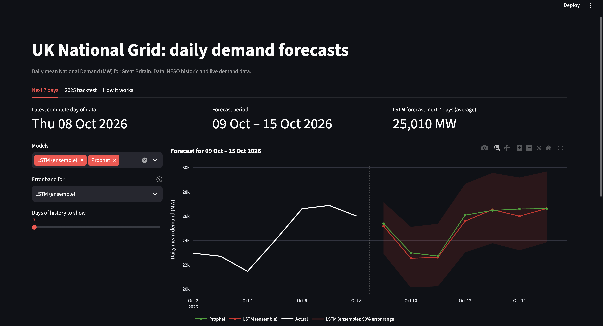
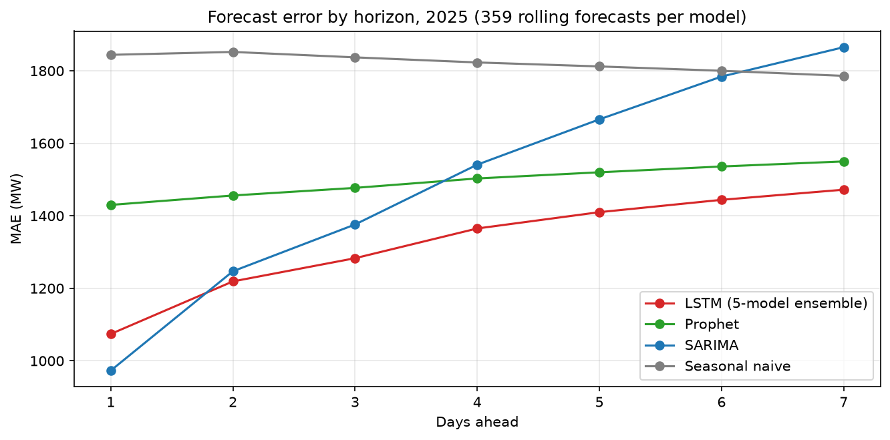

# UK Grid Demand Forecasting

Forecasting Great Britain's daily electricity demand 1–7 days ahead, comparing a seasonal-naive benchmark, SARIMA, Prophet and an LSTM on 359 rolling forecasts across 2025, with a live dashboard that forecasts the coming week from NESO's latest data.

**Live demo:** https://uk-grid-demand-forecasting-ya8y2jb5cfqi9k5ulfj45r.streamlit.app/



## Headline results

| Model | MAE (MW) | RMSE (MW) | MAPE | MASE |
|---|---|---|---|---|
| **LSTM (5-model ensemble)** | **1,324** | **1,681** | **5.08%** | **0.759** |
| SARIMA | 1,493 | 1,934 | 5.76% | 0.856 |
| Prophet | 1,496 | 1,874 | 5.77% | 0.858 |
| Seasonal naive ("same day last week") | 1,822 | 2,392 | 6.89% | 1.045 |

- **The LSTM is the most accurate model overall:** 11% lower MAE than SARIMA and Prophet, and 27% lower than seasonal naive.
- **The best model depends on how far ahead you forecast.** SARIMA is best one day ahead; the LSTM is best for days 2–7; by day 7, SARIMA is no better than "same day last week".
- **The lead isn't luck:** retrained with five different random seeds, every LSTM beat SARIMA by at least 7%.



---

## The problem

Grid operators need to know how much electricity Great Britain will use over the coming days, to plan which generation to run. This project forecasts **daily mean National Demand** (in MW) for each of the next 7 days, and asks a practical question: *does a neural network beat well-established statistical models on four years of daily data, and at which horizons?*

## Data

- **Source:** [NESO Historic Demand Data](https://www.neso.energy/data-portal/historic-demand-data), half-hourly National Demand for 2021–2025 (87,648 half-hours), plus the current year's file and NESO's Demand Data Update for the live forecast.
- **Target:** daily *mean* demand in MW (1,826 days).

### Data-quality issues found and fixed

1. **Clock-change days.** Spring and autumn clock changes give days with 46 and 50 half-hour periods. A naive timestamp formula pushed the autumn extra periods into the next day (10 duplicate timestamps). Fixed by building timestamps from UK-local midnight converted to UTC, and by aggregating on NESO's settlement date. The target is the daily **mean** rather than the sum, because a sum makes 23- and 25-hour days look about 4% low or high.
2. **A silent date-format bug.** NESO's 2025 file uses ISO dates (`2025-01-08`) while earlier years use `01-JAN-2022` or `01-Jan-23`. A flexible parser with day-first enabled **swapped day and month** for days 1–12 of every month in 2025, putting winter demand into summer. Row counts and gap checks all passed, because a swap loses no data; it showed up only as impossible winter-level spikes in summer. Fixed with explicit per-format parsing, plus a check that dates never go backwards within a file, so the pipeline now stops on any unknown format.
3. **Isolated spikes.** Half-hours more than 8,000 MW away from the rolling median of their neighbours are treated as errors and interpolated.

## Exploratory analysis: key findings

- **Weekly cycle:** weekend demand averages **11.7% below** weekdays (Sunday 12.5% below). Bank holidays average **15.3% below** normal weekdays in the same month, an even bigger dip than an ordinary weekend.
- **The yearly cycle dominates:** an MSTL decomposition puts the yearly component's range at **2.9×** the weekly one (15,928 vs 5,405 MW), peaking each winter.
- **Demand fell and levelled off:** the trend dropped from 28,309 MW (2021 average) to 26,089 MW (2023), then stayed within about 1%. Over the same period embedded solar capacity grew 52%. That's consistent with both the 2022 energy-price crisis and behind-the-meter solar, though five years of data can't separate the two.
- **Stationarity:** ADF on the raw series gives p = 0.015, so no regular differencing is needed, but the weekly and yearly cycles still have to be modelled.
- **A prediction made before modelling:** SARIMA supports only one seasonal period, so with a weekly period it can't model the dominant yearly cycle. Prophet should therefore beat it at longer horizons. (Confirmed: see results.)

## Evaluation design

- **Train on 2021–2024, test on 2025.**
- **Rolling forecast origin:** every day from 1 January to 25 December 2025, each model forecasts the next 7 days using only data up to the day before. That's **359 forecasts × 7 days per model**, mirroring how a forecast would actually be used.
- A new forecast **every day** (not weekly) means each horizon covers all seven weekdays equally, so horizon errors aren't confused with day-of-week effects.
- **Identical conditions for every model:** one shared config defines the test year and forecast dates, one shared module computes the metrics, and the comparison notebook checks that every model forecast exactly the same (origin, date) pairs.
- **Metrics:** MAE, RMSE, MAPE and **MASE** (MAE divided by the seasonal-naive error on the training years; below 1 beats the benchmark).

## Models

| Model | Inputs | How it's run in the backtest |
|---|---|---|
| Seasonal naive | Demand one week earlier | No fitting |
| SARIMA | Demand history; bank-holiday and Christmas flags | `auto_arima` chose ARIMA(1,0,0)(2,1,1)[7] on 2021–2024; updated with each new day's data |
| Prophet | Trend, weekly and yearly seasonality, bank holidays, Christmas flag | Refitted from scratch before every forecast |
| LSTM | Last 14 days of demand + calendar features; calendar of the 7 days ahead | Trained once; 5-model ensemble |

**SARIMA:** weekly differencing (`D = 1`) was set from the EDA, before any test results were seen; `d = 0` was chosen automatically, matching the ADF result.

**LSTM:**
- The LSTM summarises the recent history; a linear layer combines that summary with the calendar of the 7 days ahead and predicts all 7 days at once, so day-1 errors aren't fed back into later days.
- Day-of-week and day-of-year are encoded as sin/cos pairs, so Sunday sits next to Monday and 31 December next to 1 January. Day-of-year gives the model its position in the yearly cycle.
- Holidays for the forecast days are known in advance and given to every model, so the comparison is fair.
- **Chronological split:** train 2021–2023, validation 2024 (used only for early stopping and tuning), test 2025. The scaler is fitted on 2021–2023 only.
- Early stopping on validation loss, restoring the best weights.

### Tuning and robustness, with rules fixed before seeing test results

1. 18 combinations of lookback (14/28/56 days), hidden size (32/64/128) and learning rate (0.001/0.0003), each trained with 3 seeds and ranked by **2024 validation** MAE only.
2. The best-ranked setting (lookback 14, hidden size 128, learning rate 0.001) was used without revision. Only the learning rate made a real difference; lookback and hidden size changed validation MAE by less than the seed-to-seed variation.
3. The final model is the **average of 5 models trained with different seeds**, decided in advance to remove the luck of any single run.

| Seed | 0 | 1 | 2 | 3 | 4 | Mean ± std |
|---|---|---|---|---|---|---|
| 2025 test MAE (MW) | 1,330 | 1,327 | 1,361 | 1,387 | 1,354 | **1,352 ± 25** |

Every seed beats SARIMA (1,493 MW). The ensemble (1,324 MW) beats every individual seed. Tuning gave no meaningful gain over the default settings, which is reported rather than hidden.

## Results in detail

### Error by horizon (MAE, MW)

| Days ahead | 1 | 2 | 3 | 4 | 5 | 6 | 7 |
|---|---|---|---|---|---|---|---|
| LSTM (ensemble) | 1,074 | **1,219** | **1,283** | **1,365** | **1,410** | **1,444** | **1,472** |
| SARIMA | **973** | 1,247 | 1,376 | 1,541 | 1,666 | 1,784 | 1,865 |
| Prophet | 1,430 | 1,456 | 1,477 | 1,503 | 1,520 | 1,536 | 1,550 |
| Seasonal naive | 1,844 | 1,852 | 1,837 | 1,823 | 1,812 | 1,800 | 1,786 |

- **SARIMA wins day 1:** it uses yesterday's demand most directly. But it degrades fastest, and as winter approaches it consistently under-forecasts a week ahead, because it doesn't know where it is in the year.
- **Prophet is the flattest:** weak at day 1, but its yearly seasonality keeps it steady across the week. This confirms the EDA prediction.
- **The LSTM wins days 2–7** by combining both strengths: recent history like SARIMA, and position in the year like Prophet.

### Where every model struggles

- **Winter:** monthly errors roughly double from summer (about 900–1,200 MW) to winter (1,300–2,400 MW); January is the hardest month for three of the four models.
- **Short-lived surges:** in late November 2025, demand rose to 34,000–35,000 MW for about two weeks and every model under-forecast it by a similar margin. When all models miss together, the cause is information none of them has; a cold spell is the likely explanation.
- **The post-Christmas rebound:** all models predicted the Christmas dip but kept forecasting holiday-level demand after demand had recovered.
- **No model wins every month:** the LSTM is best in 5 months, Prophet in 5, SARIMA in 1, and seasonal naive in April. The LSTM wins overall by avoiding large failures rather than by being best everywhere.

### Leakage checks

The scaler is fitted on training years only; LSTM inputs end the day before each forecast; future inputs are calendar-only; stopping and tuning decisions use 2024 only; un-scaled targets are checked against the raw data; and every model's forecast dates are verified identical.

## Dashboard

A Streamlit app with three tabs:

- **Next 7 days:** downloads NESO's latest data (cached for 3 hours), processes it with the same code as the training data, and shows the LSTM ensemble, Prophet and seasonal-naive forecasts for the coming week, with error bands and the recent actuals. SARIMA isn't run live, because it needs a full refit on all data up to today, which is too slow for a web page.
- **2025 backtest:** choose the horizon (1–7), models and date range; see each model's forecasts against actual demand, MAE versus the naive benchmark, and error by horizon.
- **How it works:** the method in brief.

**Error bands** show the middle 90% of each model's 2025 errors at each horizon. They describe typical error rather than a formally tested prediction interval.

## Limitations and next steps

- **Weather is the biggest missing input.** The winter error pattern and the late-November miss both point to temperature. Adding temperature (and solar irradiance) as inputs is the most promising improvement.
- **One test year.** 2025 was the most regular year in the data (lowest residual noise in the EDA), so errors in noisier years would likely be higher. A multi-year backtest would show how stable the ranking is.
- **A combined forecast** (SARIMA for day 1, LSTM for days 2–7, or a weighted average) could beat every individual model.
- **Calibrated prediction intervals** (e.g. quantile loss or conformal prediction) would replace the descriptive error bands.
- **Annual maintenance:** NESO publishes a new file each year, so the live-data link in `src/config.py` needs updating each January.

## Project structure

```
uk-grid-demand-forecasting/
├── app/
│   └── app.py                 # Streamlit dashboard
├── data/
│   ├── raw/                   # NESO yearly CSVs (not committed; see "How to run")
│   └── processed/
│       └── daily_demand.csv   # cleaned daily series, 2021–2025
├── models/                    # 5 LSTM ensemble checkpoints (lstm_tuned_seed*.pt)
├── notebooks/                 # run in order: data load → data prep → EDA → baselines → LSTM → tuning → comparison
├── results/predictions/       # every model's 2025 forecasts, in one shared format
├── src/
│   ├── config.py              # shared settings: paths, test year, horizon, forecast dates, live-data links
│   ├── data_prep.py           # raw NESO files → clean daily series (used by notebooks and the app)
│   ├── metrics.py             # MAE, RMSE, MAPE, MASE
│   ├── evaluation.py          # shared scoring, saving and comparison
│   ├── lstm_config.py         # LSTM settings
│   ├── lstm_data.py           # calendar encoding, scaling, windowing
│   ├── lstm_model.py          # model and training loop
│   ├── lstm_experiments.py    # tuning and seed-check helpers
│   └── live.py                # live data download and 7-day forecasts
├── requirements.txt
└── LICENSE
```

## How to run

```bash
git clone https://github.com/Jay-Purohit1131/uk-grid-demand-forecasting.git
cd uk-grid-demand-forecasting
python3.12 -m venv .venv
source .venv/bin/activate
pip install -r requirements.txt
```

**Dashboard only:** the processed data, model checkpoints and predictions are included, so this works straight away:
```bash
streamlit run app/app.py
```

**Full pipeline:** download *Historic Demand Data* for 2021–2025 from the [NESO data portal](https://www.neso.energy/data-portal/historic-demand-data) into `data/raw/`, then run the notebooks in order. Training is deterministic: with the same seed, the LSTM reproduces the same epochs and scores.

## Tech stack

Python 3.12 · pandas · statsmodels · pmdarima · Prophet · PyTorch · scikit-learn · Streamlit · Plotly

## Licence

Code: MIT (see `LICENSE`). Data: National Energy System Operator (NESO), used under the NESO Open Data Licence.